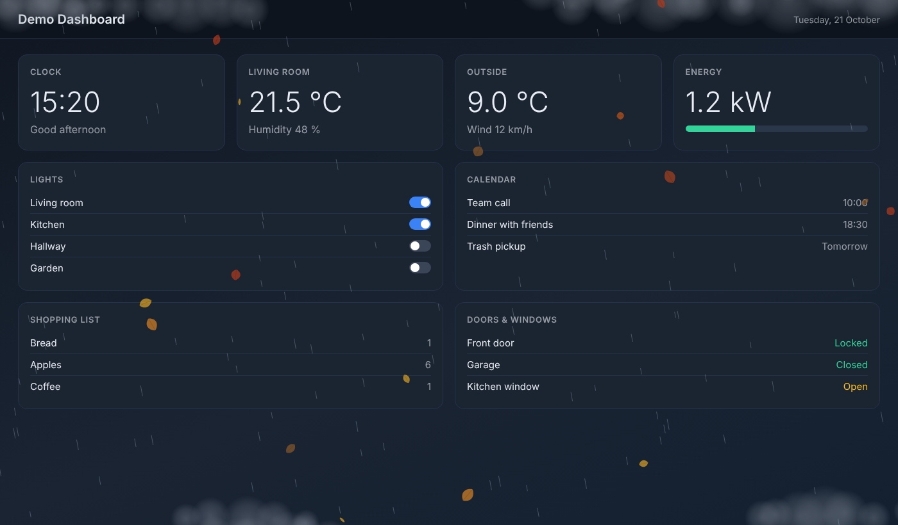
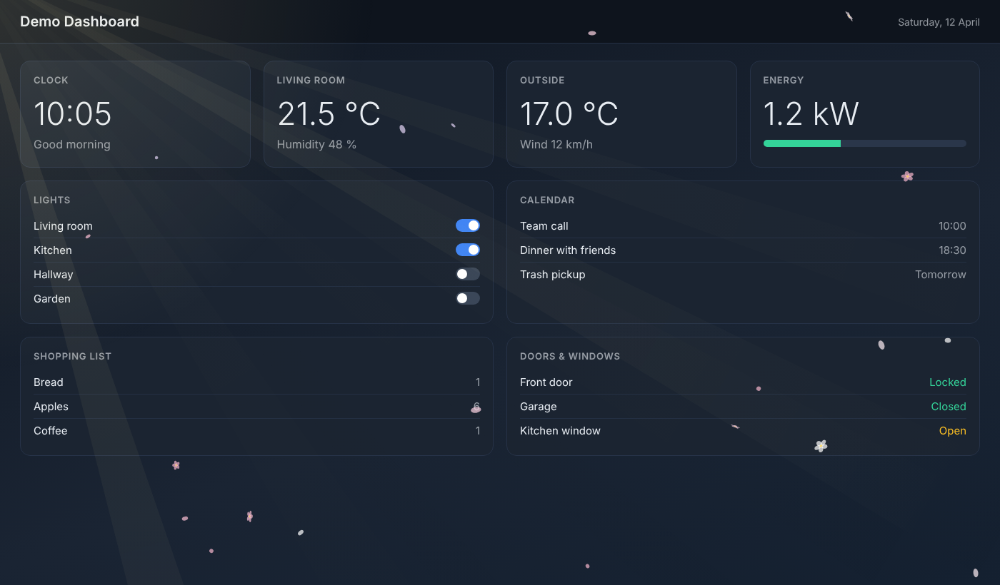
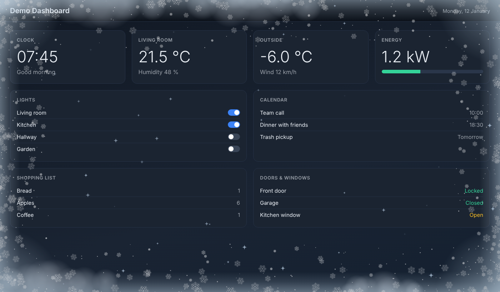
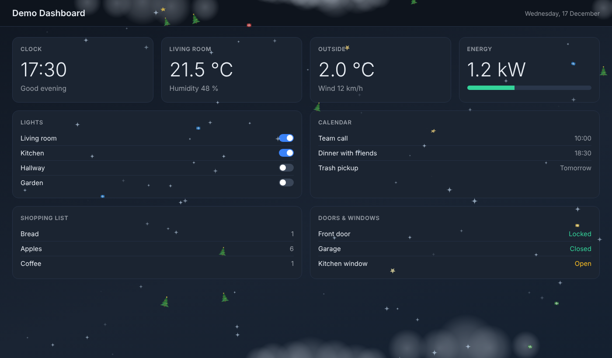
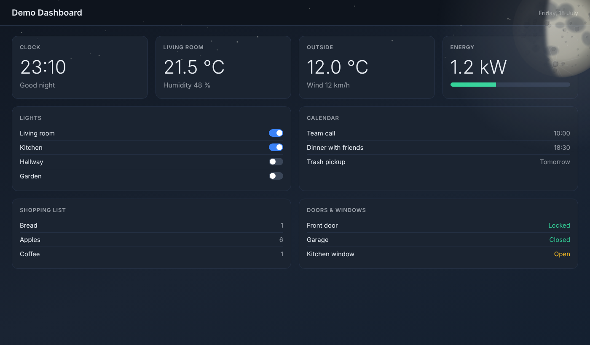
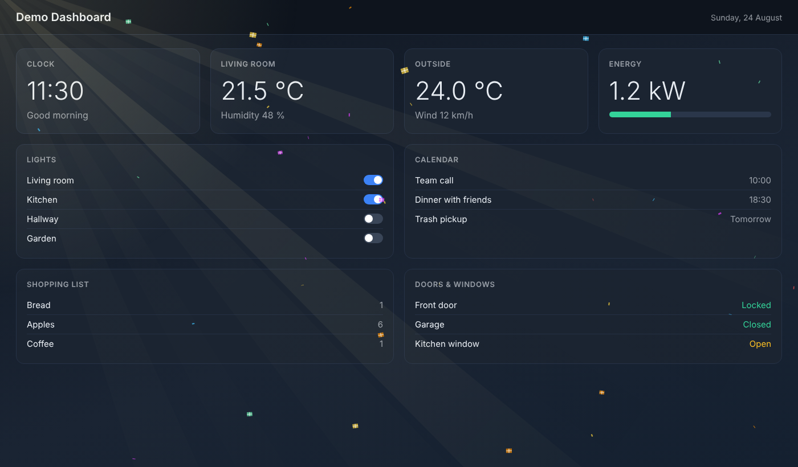

# Season Overlay Card

[English](README.md) | Deutsch

Dezentes Wetter-, Jahreszeiten- und Feiertags-Overlay für Dashboards in [Home Assistant](https://www.home-assistant.io/).

Die Karte legt einen durchsichtigen Effekt über das **ganze Dashboard**: fallende Blätter im Herbst, Blüten im Frühling, funkelnde Eiskristalle im Winter, dazu Regen, Schnee, Hagel, Wolken, Nebel und Eisränder bei Frost an den Bildschirmrändern, Sonnenstrahlen, Windböen, Sterne und ein realistisch gezeichneter Mond mit Mondphase. An bayerischen Feiertagen und an frei einstellbaren Geburtstagen fallen zusätzlich passende Figuren (z. B. Nikoläuse, Tannenbäume, Ostereier, Geschenke und Konfetti).

Das Dashboard darunter bleibt sichtbar und bedienbar. Tippt man den Bildschirm an, blendet der Effekt aus und kommt nach einigen Minuten wieder. Das ist praktisch für Wand-Tablets.

Es werden keine Bilder, Schriften oder Fremdbibliotheken geladen. Alles wird per Canvas direkt im Code gezeichnet.

## Screenshots

Die Bilder sind Momentaufnahmen eines neutralen Demo-Dashboards, im echten Dashboard ist alles animiert.

| | |
|---|---|
|  |  |
| Herbst mit Regen: fallendes Laub, Regen, Wolken am Rand | Frühling bei Sonne: Blüten und Sonnenstrahlen |
|  |  |
| Winter bei Frost: Eisränder und funkelnde Eiskristalle | Advent und Weihnachten: Tannenbäume, Geschenke und Sterne |
|  |  |
| Klare Nacht: Mond im Eck mit Mondphase | Geburtstag: Geschenke und Konfetti |

## Funktionen

| Bereich | Effekt |
|---|---|
| Jahreszeiten | Frühling: Blütenblätter und Blüten, Herbst: Laub, Winter: funkelnde Eiskristalle (optional leichter Schnee) |
| Wetter | Regen, Schnee, Schneeregen, Hagel, Wolken und Nebel an Ober- und Unterkante, Sterne bei klarer Nacht, sanftes Aufhellen bei Gewitter |
| Sonne | Sonnenstrahlen von oben links oder rechts bei `sunny` (tagsüber) |
| Wind | Windböen, die Blätter und Blüten verwirbeln; Regen fällt schräger |
| Frost | Milchige Eisränder mit Eiskristallen, wenn die Außentemperatur im Frostbereich liegt (Sensor oder Wetter-Entity) |
| Mond | Großer Mond im rechten oberen Eck mit Mondphase, Kratern und Maria |
| Feiertage (Bayern) | Neujahr/Silvester, Heilige Drei Könige, Valentinstag, Fasching, Ostern, Halloween, Martini, Nikolaus, Advent/Weihnachten |
| Geburtstage | Geschenke und Konfetti an selbst eingetragenen Tagen |

## Voraussetzungen

- Home Assistant mit Dashboards (Lovelace)
- Zugriff auf den Ordner `/config/www` (z. B. über File editor, Studio Code Server oder Samba)
- Empfohlen: eine Wetter-Entity, z. B. `weather.home`. Ohne sie gibt es nur Jahreszeit, Feiertage, Geburtstage und Mond.
- Optional: `sensor.season` (Jahreszeit; sonst wird sie aus dem Datum berechnet), `sun.sun` (Tag und Nacht), `sensor.moon` (Mondphase; sonst wird sie berechnet) und ein Temperatur-Sensor, z. B. von einer eigenen Wetterstation

## Installation

1. **Datei kopieren:** Kopiere `season-overlay-card.js` nach `/config/www/`. Gibt es den Ordner `www` noch nicht, lege ihn an und starte Home Assistant einmal neu. Danach ist die Datei unter `/local/season-overlay-card.js` erreichbar.
2. **Ressource eintragen:** Öffne *Einstellungen → Dashboards*, dann das Drei-Punkte-Menü oben rechts und *Ressourcen*. Wird „Ressourcen“ nicht angezeigt, aktiviere zuerst im Benutzerprofil den *Erweiterten Modus*. Wähle *Ressource hinzufügen* und trage ein:
   - URL: `/local/season-overlay-card.js`
   - Ressourcentyp: *JavaScript-Modul*

   Bei einem Dashboard, das komplett in YAML gepflegt wird, trägst du die Ressource dort ein:

   ```yaml
   resources:
     - url: /local/season-overlay-card.js
       type: module
   ```
3. **Seite neu laden:** Mit `Strg + F5` im Browser. In der Companion-App die App komplett schließen und neu öffnen, notfalls den Cache leeren. Bei Updates hilft ein Versionsanhang an der URL, z. B. `/local/season-overlay-card.js?v=1.6.0`.
4. **Karte einfügen:** Dashboard öffnen, *Bearbeiten*, *Karte hinzufügen*, ganz unten *Manuell* wählen und den YAML-Code eintragen:

   ```yaml
   type: custom:season-overlay-card
   weather_entity: weather.home
   ```

   Füge die Karte in **jede Ansicht** ein, in der der Effekt laufen soll. Die Karte selbst ist unsichtbar. Zum späteren Ändern nutzt du den Raw-Konfigurationseditor des Dashboards.

Die Entity-ID deiner Wetter-Integration findest du unter *Entwicklerwerkzeuge → Zustände* (nach `weather.` suchen).

## Einstellungen

Alle Optionen sind freiwillig. Eingetragen werden muss nur, was vom Standard abweichen soll.

| Option | Standard | Bedeutung |
|---|---|---|
| `weather_entity` | – | Wetter-Entity (z. B. `weather.home`). Nötig für alle Wettereffekte. |
| `season_entity` | `sensor.season` | Jahreszeit-Sensor; fehlt er, wird die Jahreszeit aus dem Datum berechnet. |
| `intensity` | `0.5` | Menge an Blättern, Blüten, Regen, Hagel, Schnee und Figuren (0 bis 3). Bei 1 ist es doppelt so viel wie im Standard. |
| `opacity` | `0.7` | Gesamt-Deckkraft des Overlays (0 bis 1). |
| `pause_minutes` | `3` | Pause nach dem Antippen, bis der Effekt zurückkehrt. |
| `winter_effect` | `sparkle` | `sparkle` (funkelnde Eiskristalle), `snow` (leichter Schnee) oder `none`. |
| `sun_rays` | `true` | Sonnenstrahlen bei `sunny` (halb so stark bei `partlycloudy`); nachts keine. |
| `sun_entity` | `sun.sun` | Entity für Tag/Nacht (Strahlen, Mond). |
| `sun_side` | `auto` | `auto` (vormittags links, nachmittags rechts), `left` oder `right`. |
| `ray_strength` | `1` | Helligkeit der Sonnenstrahlen. |
| `wind_effect` | `true` | Windböen bei `windy` oder hoher Windgeschwindigkeit; wirbeln Blätter und Blüten durcheinander. |
| `wind_speed_min` / `wind_speed_max` | `15` / `50` | Ab welcher Windgeschwindigkeit (Attribut `wind_speed`, angenommen in km/h) leichte Böen starten bzw. volle Stärke erreicht ist. |
| `sky_effects` | `true` | Wolken, Nebel, Hagel, Sterne bei klarer Nacht und sanftes Blitz-Aufhellen am Bildschirmrand. |
| `cloud_strength` | `1` | Menge der Wolken. |
| `moon` | `true` | Großer Mond im rechten oberen Eck am Abend, mit Mondphase. Bei Regen, Schnee, Hagel, Nebel und Gewitter ausgeblendet. |
| `moon_size` | `1` | Größe des Mondes (0.5 bis 2). |
| `moon_entity` | – | Optional `sensor.moon`. Ohne Angabe wird die Phase aus dem Datum berechnet (genauer als der Sensor). |
| `frost_effect` | `true` | Vereiste Ränder, wenn es draußen friert. |
| `temperature_entity` | – | Optional: Temperatur-Sensor, z. B. von der Wetterstation. Ohne Angabe wird das Attribut `temperature` der `weather_entity` genutzt. |
| `frost_temperature` | `0` | Ab dieser Temperatur (°C) abwärts gibt es Frost, volle Stärke 5 Grad darunter. |
| `frost_strength` | `1` | Breite und Dichte der Eisränder (0.3 bis 2). |
| `holidays` | `true` | Figuren an bayerischen Feiertagen und Bräuchen. |
| `holiday_strength` | `1` | Menge der Feiertagsfiguren. |
| `birthdays` | leer | Liste von Geburtstagen, an denen Geschenke und Konfetti fallen. Ohne Eintrag gibt es keinen Geburtstags-Effekt. |
| `birthday_strength` | `1` | Menge von Geschenken und Konfetti. |
| `z_index` | `100` | Ebene über dem Dashboard; nur bei Darstellungsproblemen ändern, z. B. wenn eine Karte den Effekt oder den Mond verdeckt (höher setzen). |

`ray_strength`, `cloud_strength`, `holiday_strength` und `birthday_strength` haben keine feste Obergrenze.

### Geburtstage

Das Datum wird als `MM-TT` oder `TT.MM.` angegeben. Die Namen dienen nur der Übersicht.

```yaml
type: custom:season-overlay-card
weather_entity: weather.home
birthdays:
  - { date: '03-15', name: Anna }
  - { date: '21.07.', name: Max }
  - { date: '11-30', name: Oma }
```

### Frost und Wetterstation

Der Frost-Effekt hängt nicht am Wetterzustand, sondern an der Außentemperatur. Liegt sie bei oder unter `frost_temperature` (Standard 0 °C), legen sich Eisränder und kleine Eiskristalle an alle vier Bildschirmränder: bei 0 °C leicht, 5 Grad darunter in voller Stärke. Die Temperatur kommt aus `temperature_entity` (z. B. von der eigenen Wetterstation), sonst aus dem Attribut `temperature` der `weather_entity`. Ist der Sensor nicht verfügbar, wird automatisch die Wetter-Entity genutzt. Fahrenheit-Werte werden umgerechnet.

```yaml
type: custom:season-overlay-card
weather_entity: weather.home
temperature_entity: sensor.wetterstation_aussentemperatur
frost_temperature: 0
frost_strength: 1
```

## Feiertage und Wetter

### Feiertage und Bräuche (Bayern)

Die Daten berechnet die Karte selbst (Ostern per Formel, 1. Advent aus dem Weihnachtsdatum).

| Anlass (`test_holiday`) | Zeitraum | Figuren |
|---|---|---|
| `neujahr` | 31.12. und 1.1. | Konfetti und Sterne |
| `dreikoenig` | 5. und 6.1. | Sterne und Kronen |
| `valentin` | 13. und 14.2. | Herzen |
| `fasching` | Weiberfasching bis Faschingsdienstag | Konfetti und Sterne |
| `ostern` | Palmsonntag bis Ostermontag (inkl. Karfreitag) | bunte Eier |
| `halloween` | 29. bis 31.10. | Kürbisse |
| `martini` | 10. und 11.11. | Laternen |
| `nikolaus` | 5. und 6.12. | Nikoläuse mit roter Mütze und Sterne |
| `weihnachten` | 1. Advent bis 26.12. | Tannenbäume, Geschenke und Sterne |

Für Christi Himmelfahrt, Pfingsten, Fronleichnam, Mariä Himmelfahrt, 1. Mai, 3. Oktober und Allerheiligen gibt es keine eigene Figur.

### Jahreszeiten

| Jahreszeit | Effekt |
|---|---|
| Frühling | Blütenblätter und kleine Blüten in Rosa, Weiß und Flieder |
| Sommer | kein eigener Effekt (Wetter, Sonne und Mond wirken weiter) |
| Herbst | Fallendes Laub in Orange-, Rot- und Brauntönen |
| Winter | Funkelnde Eiskristalle, die langsam glitzern (`winter_effect: snow` für leichten Schnee) |

### Wetter

| Wetter (`test_weather`) | Effekt |
|---|---|
| `sunny` | Sonnenstrahlen von oben links oder rechts (tagsüber) |
| `partlycloudy` | Wenige helle Wolken, halb starke Strahlen |
| `cloudy` | Graue Wolken an Ober- und Unterkante |
| `rainy`, `pouring` | Regen und dunklere Wolken |
| `lightning`, `lightning-rainy` | Dunkle Wolken (bei `lightning-rainy` zusätzlich Regen) und alle paar Sekunden ein sanftes Aufhellen von oben |
| `snowy`, `snowy-rainy` | Schnee (bzw. Schneeregen) und helle Wolken |
| `hail` | Fallende Hagelkörner und Wolken |
| `fog` | Nebelbänder an Ober- und Unterkante |
| `clear-night` | Funkelnde Sterne am oberen Rand (und der Mond) |
| `windy`, `windy-variant` | Windböen, die Blätter und Blüten verwirbeln, Wolken ziehen schneller |

## Test-Schalter

Damit lassen sich Effekte ausprobieren, ohne auf das passende Wetter oder Datum zu warten. Im Normalbetrieb bitte wieder entfernen.

| Option | Werte | Wirkung |
|---|---|---|
| `test_season` | `spring`, `summer`, `autumn`, `winter` | Erzwingt eine Jahreszeit. |
| `test_weather` | alle Wetter-Zustände aus der Tabelle oben | Erzwingt ein Wetter. |
| `test_wind` | 0 bis 1 | Erzwingt eine Windstärke. |
| `test_holiday` | Schlüssel aus der Feiertagstabelle, `none` | Zeigt einen Feiertag; `none` schaltet die Feiertagsfiguren aus. |
| `test_night` | `true` | Zeigt den Mond auch tagsüber. |
| `test_moon` | 0 bis 1 | Mondphase: 0 Neumond, 0.25 zunehmender Halbmond, 0.5 Vollmond, 0.75 abnehmender Halbmond. |
| `test_birthday` | `true` | Zeigt Geschenke und Konfetti sofort. |
| `test_frost` | 0 bis 1 | Erzwingt Frost in dieser Stärke, unabhängig von der Temperatur. |

Beispiel:

```yaml
type: custom:season-overlay-card
weather_entity: weather.home
intensity: 1
test_season: autumn
test_weather: rainy
test_night: true
test_moon: 0.5
```

## Fehlerbehebung

| Problem | Lösung |
|---|---|
| Nichts zu sehen | Ressource korrekt eingetragen (Typ *JavaScript-Modul*)? Seite mit `Strg + F5` neu laden. Ist die Karte in dieser Ansicht eingefügt? Mit `test_weather: rainy` und `intensity: 1` prüfen. |
| Fehlermeldung „Custom element doesn't exist“ | Ressource fehlt oder die URL stimmt nicht. Prüfe, ob `/local/season-overlay-card.js` im Browser aufrufbar ist. Beim ersten Anlegen von `www` ist ein Neustart nötig. |
| Keine Wettereffekte | `weather_entity` fehlt oder ist falsch geschrieben. Entity-ID unter *Entwicklerwerkzeuge → Zustände* prüfen. |
| Effekt ist verschwunden | Das ist gewollt: Nach dem Antippen blendet er aus und kommt nach `pause_minutes` zurück. |
| Zu viel oder zu wenig los | `intensity`, `opacity` sowie `cloud_strength`, `holiday_strength` anpassen. |
| Ruckeln auf Tablet oder Wand-PC | `intensity` senken (unter 1) oder einzelne Effekte abschalten (`sky_effects: false`, `moon: false`). |
| Änderung an der Datei wirkt nicht | Browser- bzw. App-Cache. `Strg + F5` oder URL mit `?v=`-Zähler in der Ressource verwenden. |

## Hinweise

- Dieses Projekt ist ein inoffizielles Community-Projekt und steht in keiner Verbindung zu Home Assistant oder dem Open Home Foundation.
- Die Software wird ohne Gewährleistung bereitgestellt (siehe Lizenz).

## Lizenz

[MIT](LICENSE)
