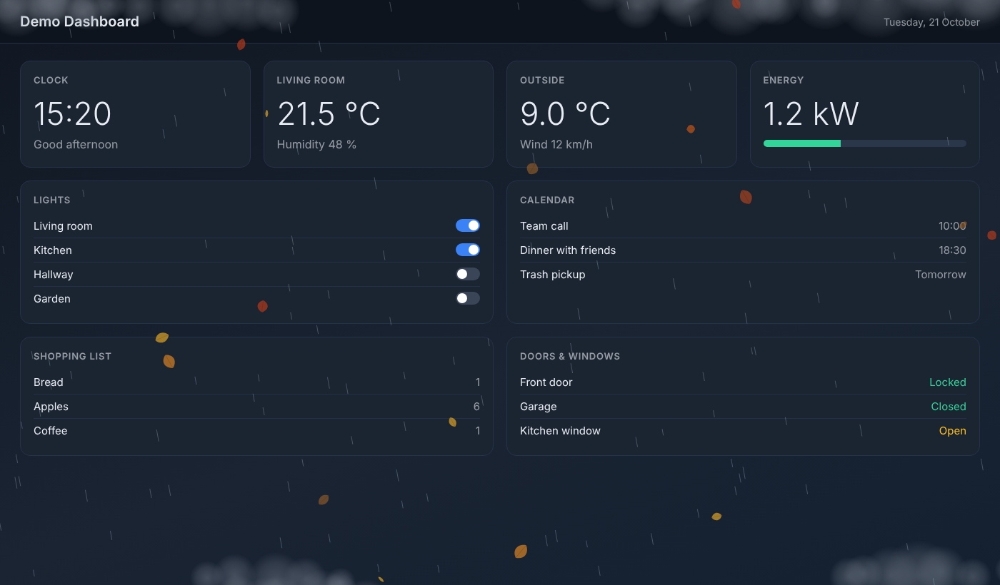
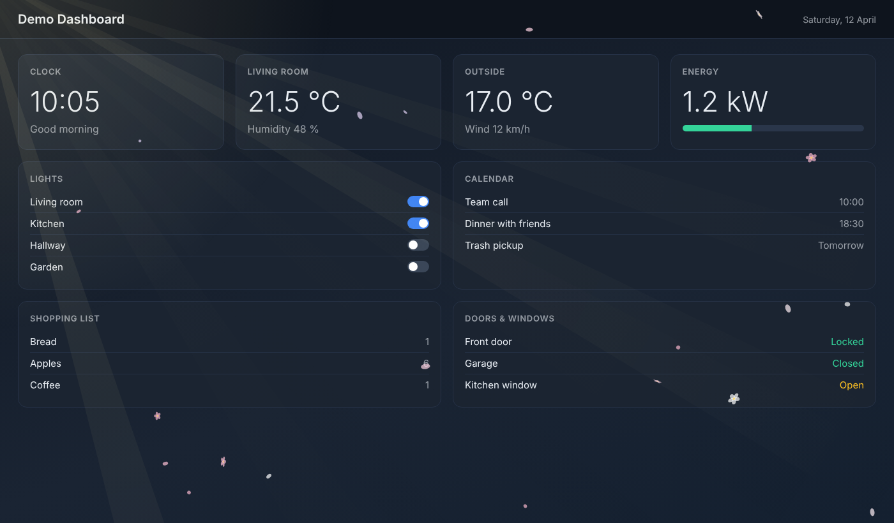
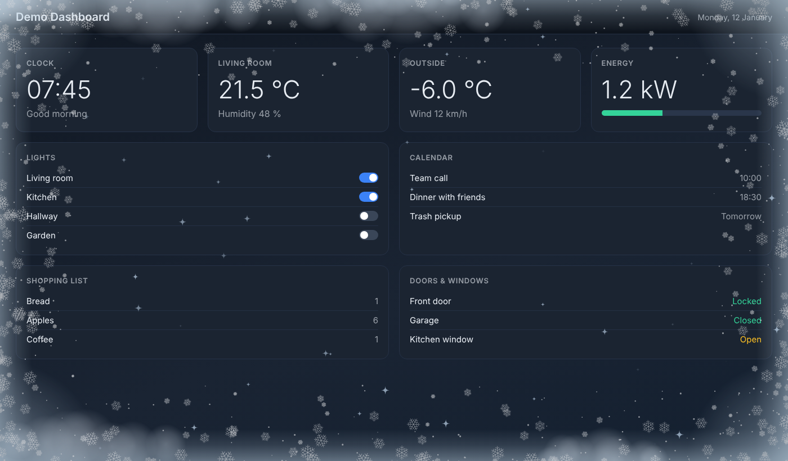
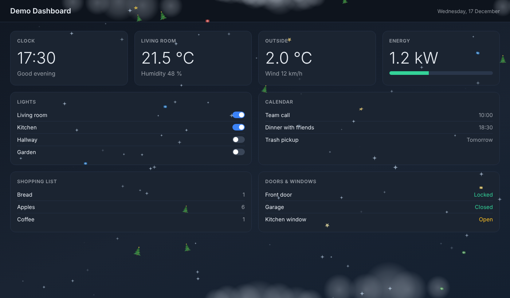
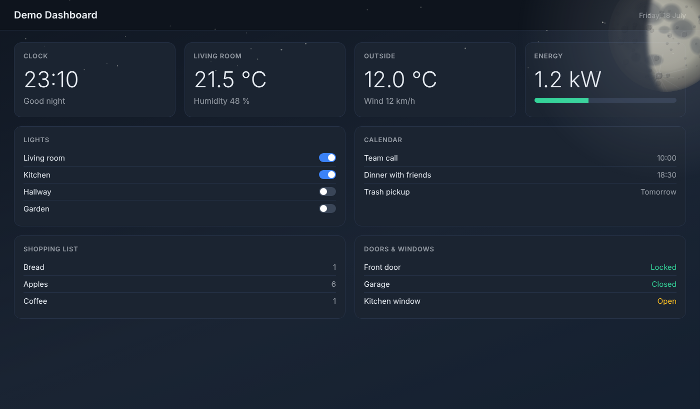
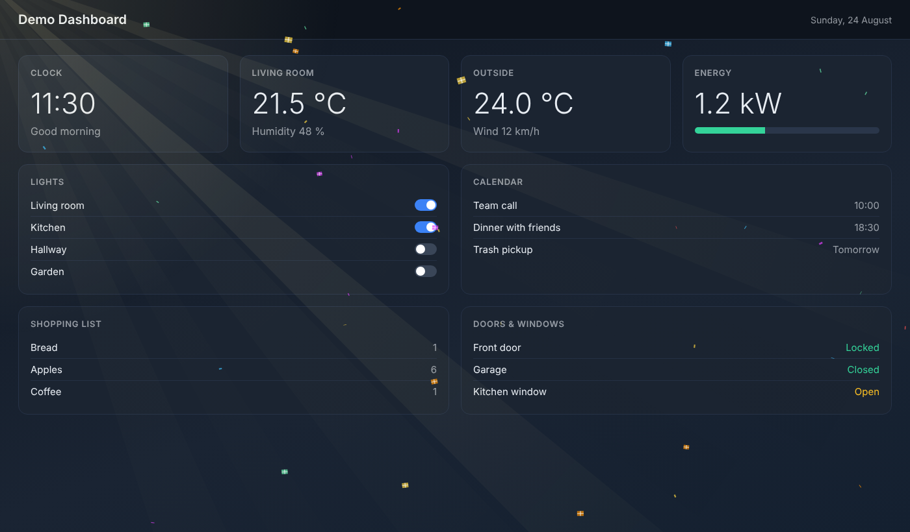

# Season Overlay Card

English | [Deutsch](README.de.md)

A subtle weather, season and holiday overlay for [Home Assistant](https://www.home-assistant.io/) dashboards.

The card lays a transparent effect over the **whole dashboard**: falling leaves in autumn, blossoms in spring, twinkling ice crystals in winter, plus rain, snow, hail, clouds, fog and frosted edges at the borders of the screen, sun rays, wind gusts, stars and a realistically drawn moon with its current phase. On Bavarian holidays and on birthdays you define, matching figures fall as well (e.g. Santa Clauses, Christmas trees, Easter eggs, gifts and confetti).

The dashboard underneath stays visible and fully usable. When you tap the screen, the effect fades out and returns after a few minutes, which is handy for wall-mounted tablets.

No images, fonts or third-party libraries are loaded. Everything is drawn on a canvas directly in the code.

## Screenshots

The images are snapshots of a neutral demo dashboard. In a real dashboard everything is animated.

| | |
|---|---|
|  |  |
| Autumn with rain: falling leaves, rain, clouds at the edges | Spring with sun: blossoms and sun rays |
|  |  |
| Winter with frost: frosted edges and twinkling ice crystals | Advent and Christmas: trees, gifts and stars |
|  |  |
| Clear night: moon in the corner with its phase | Birthday: gifts and confetti |

## Features

| Area | Effect |
|---|---|
| Seasons | Spring: petals and blossoms, autumn: leaves, winter: twinkling ice crystals (optionally light snow) |
| Weather | Rain, snow, sleet, hail, clouds and fog along the top and bottom edges, stars on clear nights, soft lightning flashes |
| Sun | Sun rays from the top left or right on `sunny` (daytime) |
| Wind | Gusts that swirl leaves and blossoms around; rain falls at a slant |
| Frost | Milky frosted edges with ice crystals when the outside temperature is at or below freezing (sensor or weather entity) |
| Moon | Large moon in the top right corner with its phase, craters and maria |
| Holidays (Bavaria) | New Year / New Year's Eve, Epiphany, Valentine's Day, Carnival, Easter, Halloween, St. Martin's Day, St. Nicholas, Advent / Christmas |
| Birthdays | Gifts and confetti on days you enter yourself |

## Requirements

- Home Assistant with dashboards (Lovelace)
- Access to the `/config/www` folder (e.g. via File editor, Studio Code Server or Samba)
- Recommended: a weather entity, e.g. `weather.home`. Without it you only get seasons, holidays, birthdays and the moon.
- Optional: `sensor.season` (season; otherwise it is calculated from the date), `sun.sun` (day and night), `sensor.moon` (moon phase; otherwise it is calculated) and a temperature sensor, e.g. from your own weather station

## Installation

1. **Copy the file:** Copy `season-overlay-card.js` to `/config/www/`. If the `www` folder does not exist yet, create it and restart Home Assistant once. Afterwards the file is available at `/local/season-overlay-card.js`.
2. **Add the resource:** Open *Settings → Dashboards*, then the three-dot menu at the top right and *Resources*. If "Resources" is not shown, enable *Advanced mode* in your user profile first. Choose *Add resource* and enter:
   - URL: `/local/season-overlay-card.js`
   - Resource type: *JavaScript Module*

   If you manage your dashboard completely in YAML, add the resource there instead:

   ```yaml
   resources:
     - url: /local/season-overlay-card.js
       type: module
   ```
3. **Reload the page:** Press `Ctrl + F5` in the browser. In the companion app, close the app completely and reopen it, and clear the cache if necessary. For updates, a version suffix on the URL helps, e.g. `/local/season-overlay-card.js?v=1.6.0`.
4. **Add the card:** Open the dashboard, click *Edit*, *Add card*, scroll to the bottom and choose *Manual*, then enter the YAML:

   ```yaml
   type: custom:season-overlay-card
   weather_entity: weather.home
   ```

   Add the card to **every view** in which the effect should run. The card itself is invisible. To change it later, use the dashboard's raw configuration editor.

You can find the entity ID of your weather integration under *Developer tools → States* (search for `weather.`).

## Options

All options are optional. Only enter what should differ from the default.

| Option | Default | Description |
|---|---|---|
| `weather_entity` | – | Weather entity (e.g. `weather.home`). Needed for all weather effects. |
| `season_entity` | `sensor.season` | Season sensor; if it is missing, the season is calculated from the date. |
| `intensity` | `0.5` | Amount of leaves, blossoms, rain, hail, snow and figures (0 to 3). At 1 there is twice as much as by default. |
| `opacity` | `0.7` | Overall opacity of the overlay (0 to 1). |
| `pause_minutes` | `3` | Pause after a tap until the effect returns. |
| `winter_effect` | `sparkle` | `sparkle` (twinkling ice crystals), `snow` (light snow) or `none`. |
| `sun_rays` | `true` | Sun rays on `sunny` (half as strong on `partlycloudy`); none at night. |
| `sun_entity` | `sun.sun` | Entity for day/night (rays, moon). |
| `sun_side` | `auto` | `auto` (left in the morning, right in the afternoon), `left` or `right`. |
| `ray_strength` | `1` | Brightness of the sun rays. |
| `wind_effect` | `true` | Wind gusts on `windy` or high wind speed; they swirl leaves and blossoms around. |
| `wind_speed_min` / `wind_speed_max` | `15` / `50` | Wind speed (attribute `wind_speed`, assumed to be in km/h) at which light gusts start and at which they reach full strength. |
| `sky_effects` | `true` | Clouds, fog, hail, stars on clear nights and soft lightning flashes along the screen edges. |
| `cloud_strength` | `1` | Amount of clouds. |
| `moon` | `true` | Large moon in the top right corner in the evening, with its phase. Hidden during rain, snow, hail, fog and thunderstorms. |
| `moon_size` | `1` | Size of the moon (0.5 to 2). |
| `moon_entity` | – | Optional `sensor.moon`. Without it the phase is calculated from the date (more precise than the sensor). |
| `frost_effect` | `true` | Frosted edges when it is freezing outside. |
| `temperature_entity` | – | Optional: temperature sensor, e.g. from your weather station. Without it, the `temperature` attribute of the `weather_entity` is used. |
| `frost_temperature` | `0` | Frost starts at this temperature (°C) and below; full strength 5 degrees lower. |
| `frost_strength` | `1` | Width and density of the frosted edges (0.3 to 2). |
| `holidays` | `true` | Figures on Bavarian holidays and customs. |
| `holiday_strength` | `1` | Amount of holiday figures. |
| `birthdays` | empty | List of birthdays on which gifts and confetti fall. Without entries there is no birthday effect. |
| `birthday_strength` | `1` | Amount of gifts and confetti. |
| `z_index` | `100` | Layer above the dashboard; only change it if there are display problems, e.g. when another card covers the effect or the moon (set it higher). |

`ray_strength`, `cloud_strength`, `holiday_strength` and `birthday_strength` have no fixed upper limit.

### Birthdays

The date is given as `MM-DD` or `DD.MM.`. The names are only there to keep the list readable.

```yaml
type: custom:season-overlay-card
weather_entity: weather.home
birthdays:
  - { date: '03-15', name: Anna }
  - { date: '21.07.', name: Max }
  - { date: '11-30', name: Grandma }
```

### Frost and weather station

The frost effect does not depend on the weather state but on the outside temperature. If it is at or below `frost_temperature` (default 0 °C), frosted edges and small ice crystals appear on all four edges of the screen: light at 0 °C, full strength 5 degrees below. The temperature comes from `temperature_entity` (e.g. your own weather station), otherwise from the `temperature` attribute of the `weather_entity`. If the sensor is unavailable, the weather entity is used automatically. Fahrenheit values are converted.

```yaml
type: custom:season-overlay-card
weather_entity: weather.home
temperature_entity: sensor.weather_station_outdoor_temperature
frost_temperature: 0
frost_strength: 1
```

## Holidays and weather

### Holidays and customs (Bavaria)

The card calculates the dates itself (Easter by formula, the first Sunday of Advent from the date of Christmas).

| Occasion (`test_holiday`) | Period | Figures |
|---|---|---|
| `neujahr` | Dec 31 and Jan 1 | Confetti and stars |
| `dreikoenig` | Jan 5 and 6 | Stars and crowns |
| `valentin` | Feb 13 and 14 | Hearts |
| `fasching` | Weiberfasching to Shrove Tuesday | Confetti and stars |
| `ostern` | Palm Sunday to Easter Monday (incl. Good Friday) | Colourful eggs |
| `halloween` | Oct 29 to 31 | Pumpkins |
| `martini` | Nov 10 and 11 | Lanterns |
| `nikolaus` | Dec 5 and 6 | Santa Clauses with red hats and stars |
| `weihnachten` | First Sunday of Advent to Dec 26 | Christmas trees, gifts and stars |

There is no dedicated figure for Ascension Day, Whit Monday, Corpus Christi, Assumption Day, May 1, October 3 or All Saints' Day.

### Seasons

| Season | Effect |
|---|---|
| Spring | Petals and small blossoms in pink, white and lilac |
| Summer | No effect of its own (weather, sun and moon still apply) |
| Autumn | Falling leaves in orange, red and brown |
| Winter | Slowly twinkling ice crystals (`winter_effect: snow` for light snow) |

### Weather

| Weather (`test_weather`) | Effect |
|---|---|
| `sunny` | Sun rays from the top left or right (daytime) |
| `partlycloudy` | A few light clouds, half-strength rays |
| `cloudy` | Grey clouds along the top and bottom edges |
| `rainy`, `pouring` | Rain and darker clouds |
| `lightning`, `lightning-rainy` | Dark clouds (plus rain on `lightning-rainy`) and a soft brightening from above every few seconds |
| `snowy`, `snowy-rainy` | Snow (or sleet) and light clouds |
| `hail` | Falling hailstones and clouds |
| `fog` | Fog banks along the top and bottom edges |
| `clear-night` | Twinkling stars along the top edge (and the moon) |
| `windy`, `windy-variant` | Gusts that swirl leaves and blossoms around, clouds move faster |

## Test switches

These let you try out effects without waiting for the right weather or date. Please remove them again for normal operation.

| Option | Values | Effect |
|---|---|---|
| `test_season` | `spring`, `summer`, `autumn`, `winter` | Forces a season. |
| `test_weather` | any weather state from the table above | Forces a weather state. |
| `test_wind` | 0 to 1 | Forces a wind strength. |
| `test_holiday` | key from the holiday table, `none` | Shows a holiday; `none` turns the holiday figures off. |
| `test_night` | `true` | Shows the moon during the day as well. |
| `test_moon` | 0 to 1 | Moon phase: 0 new moon, 0.25 waxing half moon, 0.5 full moon, 0.75 waning half moon. |
| `test_birthday` | `true` | Shows gifts and confetti right away. |
| `test_frost` | 0 to 1 | Forces frost at this strength, regardless of the temperature. |

Example:

```yaml
type: custom:season-overlay-card
weather_entity: weather.home
intensity: 1
test_season: autumn
test_weather: rainy
test_night: true
test_moon: 0.5
```

## Troubleshooting

| Problem | Solution |
|---|---|
| Nothing visible | Is the resource added correctly (type *JavaScript Module*)? Reload the page with `Ctrl + F5`. Is the card added to this view? Check with `test_weather: rainy` and `intensity: 1`. |
| Error "Custom element doesn't exist" | The resource is missing or the URL is wrong. Check whether `/local/season-overlay-card.js` can be opened in the browser. When `www` is created for the first time, a restart is required. |
| No weather effects | `weather_entity` is missing or misspelled. Check the entity ID under *Developer tools → States*. |
| The effect disappeared | That is intended: after a tap it fades out and returns after `pause_minutes`. |
| Too much or too little going on | Adjust `intensity`, `opacity`, `cloud_strength` and `holiday_strength`. |
| Stuttering on a tablet or wall PC | Lower `intensity` (below 1) or turn off individual effects (`sky_effects: false`, `moon: false`). |
| Changes to the file have no effect | Browser or app cache. Use `Ctrl + F5` or add a `?v=` counter to the resource URL. |

## Notes

- This is an unofficial community project and is not affiliated with Home Assistant or the Open Home Foundation.
- The software is provided without warranty (see the license).

## License

[MIT](LICENSE)
